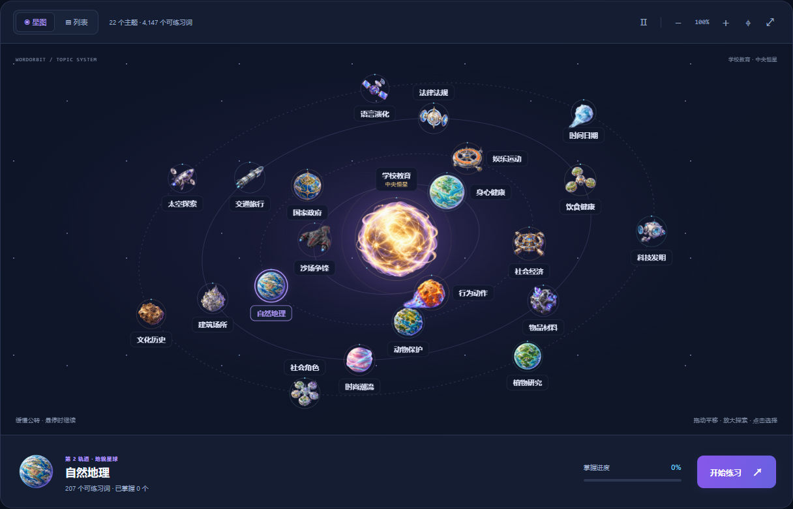
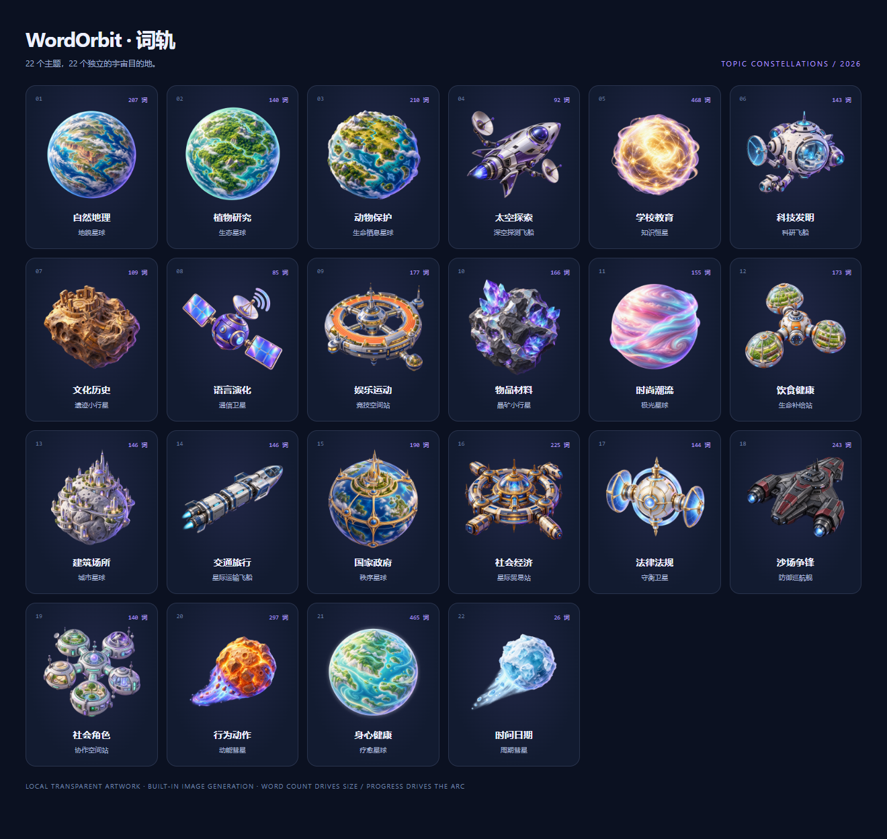

# 词轨 WordOrbit

词轨是一款用于雅思词汇复习的 Windows 离线桌面应用。它把按主题整理的词库、多种练习、错题回练和学习进度放在一个窗口中。程序启动后无需联网，学习记录保存在你的电脑上。

## 下载与运行

当前发布版：**[v1.6.1，仅支持 Windows ARM64](https://github.com/yilaxin/WordOrbit/releases/tag/v1.6.1)**。在 GitHub Releases 下载 `WordOrbit-v1.6.1-win-arm64.zip`，完整解压后打开其中的 `VocabDesk.exe`。请保留解压后的整个文件夹；程序需要同目录下的 `Website`、`Assets` 和其他运行文件。系统还需安装 Microsoft Edge WebView2 Runtime。

这不是手机 App，也尚未提供 Windows x64、macOS 或 Linux 安装包。程序使用 .NET 10 WPF 和 WebView2；词库与例句随程序放在本机，练习时不需要登录账号。

## 主要功能

| 功能 | 用法 |
| --- | --- |
| 今日复习 | 首页显示待复习词、当天进度和已掌握数量，可直接开始当天练习。 |
| 多种题型 | 混合练习轮换英文选中文、中文选英文、填空、拼写和听音；也可选择专项题型。听音题使用系统语音功能。 |
| 自定练习 | 选择题型、题量、主题范围和智能、随机或顺序出题；选择题可按 `1`、`2`、`3`、`4` 作答。 |
| 整本遍历 | 每轮从全书词库随机抽取 50 个词：前 50 题英文选中文，后 50 题用同一批词中文选英文，两段各自打乱；做错的题排到本轮末尾重做。 |
| 答题反馈 | 提交后显示正误、完整中文释义、音标、词性、来源主题与页码；有可靠资料时显示英汉例句和词族衍生词。 |
| 错题与收藏 | 错题重练处理薄弱词；收藏建立重点词单。练习中可听发音、查看题目导航并续做未完成的训练。 |
| 浏览词库 | 按单词、释义、主题和学习状态搜索筛选；可编辑个人释义、例句、标签和笔记，也能导入 JSON 词表。 |
| 学习数据 | 查看累计作答、正确率、已掌握词、连续学习、近 30 天活动和主题表现；可清空本次训练、当天或全部学习数据。 |
| 备份与迁移 | 在词库页导出 JSON；桌面版右上角 `⋯` 可导入旧网页版 JSON，导入前会备份当前记录。 |
| 星云文章学习 | 粘贴英文文章，分类收藏、点词查离线词典、记阅读笔记与佳句，从文章生词开始原句填空和中译英回忆。私人文章数据独立保存。 |
| 我的词库 | 单个添加单词或短语、批量粘贴并预览去重；加入独立私人星球，支持英选中、中选英、混合练习及独立备份。 |
| 生活彗星 | 记录生活场景及对应英语，在当天三维星空自由飞行；按日期回想，英文默认隐藏，支持编辑、删除及独立私人备份。 |

## v1.6.1：修复主题图标，保留三维航行

上一版将 10 个飞船、卫星和空间站换成简化灰白几何体，同时把原插画缩成小徽标，造成风格割裂和重复叠图。v1.6.1 移除这层替代模型，恢复每个目的地的原精细插画作为唯一主体，不再挤到角落。飞船按各自机头方向校准、随投影航向平滑转向；空间站保持稳定姿态。原有三维位置、前后远近、相机旋转、卫星宿主、探索/巡航、选择与练习入口均保留。中央恒星仍可带一个原主题徽标，以标明动态当选的主题。

这些是三维空间中的面向屏幕插画，不是可展示任意侧面的完整三维模型。恢复图标不需要清空学习记录；关闭旧窗口并重新打开新版即可。去掉 10 个独立模型画布，只保留共享轨道画布和已有本地图片。

## 三维主题星系（v1.6.0 引入，v1.6.1 修正外观）

首页主题星图升级为具有 XYZ 坐标、透视、前后遮挡和可旋转镜头的星系，沿用彗星板块的本地银河背景。**不是把几千个单词同时画成粒子**：仍只有 22 个公共主题及一个可选的私人星球；搜索词表和列表模式保留。

- **不同角色不同运动**：行星绕恒星运行，卫星绕宿主行星运行并朝向宿主，空间站保持相对宿主的驻留位置；探索船有观察、加速、巡航和接近减速过程，运输船走补给航线，战舰在外缘低速巡航，彗星走长椭圆航迹。飞船逐渐转向，不开火、不制造爆炸。
- **图形边界**：所有主题使用原精细插画，处于同一个三维投影空间；随透视改变位置和屏幕大小，飞船及卫星按投影方向转动，空间站不翻滚。插画保持完整比例与清晰正面，不宣称为任意视角的完整三维模型。v1.6.0 的 10 个简化几何模型与重复徽标已移除。
- **探索与学习**：拖动空白处旋转，方向键调整视角；普通滚轮滚动页面，Ctrl＋滚轮、双指或＋/−按钮缩放，0/复位回到全景。点击元素聚焦并全场停泊，信息卡显示词量、已掌握、待复习、未开始和当前行为，可“开始练习”或“浏览单词”。Esc/返回星系恢复总览；全屏中先退出聚焦，再按 Esc 收起全屏。
- **找得到、看得清**：新增主题搜索（Enter 定位）、目的地选择及待复习/未开始筛选；不匹配目的地降低亮度但不重排轨道。标签保持朝向屏幕并避让，拥挤时隐藏部分普通标签，悬停/键盘聚焦/选中时优先显示。恒星由公共主题可练习词量最多者担任，保持明显较大的尺寸；私人星球不竞争中央恒星。
- **关系不改分类**：卫星和空间站的宿主只是空间表现，不是词库从属，卡片明确注明。私人星球只读汇总，不把私人词条装入公共星图。题库、整本遍历、错题、音标提示规则、文章和各类独立备份不变。
- **按需运行**：复用已有图片，无新增运行时三维框架。原生投影绘制最多约 25 帧/秒，限制画布像素密度；暂停、选中停泊后镜头完成过渡即停止持续绘图，隐藏或离屏停止动画，列表/离开首页移除场景画布、背景及星体节点。系统减少动态效果与全局关闭动效仍生效。

完整的 22 主题行为与宿主对应见 [三维星系说明](docs/TOPIC_UNIVERSE_v1.6.0.md)。升级无需清空学习记录。首页星图现在也会按需使用银河图片，因此 v1.5.2 中“仅彗星板块使用该背景”的范围已扩展，但私人彗星记录仍只在彗星板块加载。

## v1.5.2：让生活彗星飞进银河

彗星区域使用原创 AI 生成的蓝紫银河背景：密集细星点、云雾般的银河尘带、深蓝夜空与朦胧辉光。背景图中没有固定彗星；可选中的生活彗星仍由原三维场景独立绘制，记录、回忆及备份功能不变。标签、状态和手势提示增加浅暗底，保持文字可读，并延续普通滚轮滚动、Ctrl＋滚轮缩放的操作。

- 背景仅在进入彗星板块后作为本地静态图片加载，没有新增星云粒子循环、视频或三维库。宽屏 1536×864 WebP 约 378 KB，窄屏 768×432 约 102 KB，浏览器按显示尺寸和像素密度选择。原有额外三维星点由 540 减为 160，避免与背景重复密集绘制；离开时移除背景 DOM 和三维资源。浏览器自身可保留压缩图片缓存供重用，不承诺进程内存即时归零。
- 桌面包仅包含显示尺寸资源；原始生成图片和最终提示词保存在 [design/comets-background-prompt.md](design/comets-background-prompt.md) 所列位置，不包含用户上传的参考原图。可用 `scripts/Build-CometBackground.cjs`（开发环境有 sharp 时）机械重建显示图片；App 无 Node/sharp 运行依赖。
- 网页离线缓存同步包含两档背景；新增宽/窄屏加载、透明交互层、答案展开与离开释放回归，并在桌面隔离自检中检查背景实际加载。私人数据库、题库词数和备份格式不变。

## v1.5.1：修复彗星添加入口与滚轮

修复空星空中央“留下第一颗彗星”按钮被三维拖动层捕获鼠标、实际点击打不开编辑框的问题。普通滚轮现在滚动页面，**Ctrl＋滚轮**或星空右下角 **＋ / −** 才缩放视角，与首页主题星图的操作保持一致。短窗口编辑框可滚动，取消/保存操作固定在框内底部；每次打开从顶部开始。新增真实指针和滚轮输入回归测试，并在桌面 WebView2 隔离自检中覆盖添加、滚动和保存。私人数据与备份格式不变，升级无需清空或重新导入。

## v1.5.0：生活彗星，把今天留在星空中

点击顶部 **彗星 → 记录一颗彗星**，填写生活片段标题和对应英语，可补充日期、时间、场景提示、中文释义与场景标签。每次保存生成一颗属于你的生活彗星；不自动联网翻译、识图或生成句子，不会插入预览的示例记录。

- **三维星空**：白炽彗核与青蓝—淡紫长尾在有远近的三维空间自由飞行，拖动旋转视角，普通滚轮滚动页面，Ctrl＋滚轮、双指或按钮缩放。悬停只暂停指向的彗星，点击后全场停泊，回忆卡出现在旁边。轨迹按记录编号固定生成，不依赖主题或书中顺序。
- **先回忆，再确认**：回忆卡先显示生活场景，不把对应英语放入可见/隐藏答案 DOM。点击“想一想，再展开英文”才显示英语及中文释义；可以收起再想一次，或按 Escape 返回星空。当天清单也可定位不在视野内的彗星。
- **按天回看**：日期选择、前后一天、“回到今天”及“有记录的日期”用于找回过去的生活片段。每片星空最多 12 颗，同一天更多记录可翻页，避免重叠与资源增长。
- **独立私人备份**：彗星只存本机 IndexedDB `wordorbit-comets-private-v1`，不写入公开词库、代码、Release、统计或其他备份。点击“独立备份”导出 `wordorbit-comets-backup-日期-partXX.json`；大备份约每 18 MB 分卷，恢复时逐个导入（每卷最多 20 MB）。恢复前校验整卷，确认后一次事务写入；重复编号或相同内容跳过，不覆盖已有内容。只接受彗星专用格式，不混用题库、星云或我的词库备份。最多 10,000 条生活记录。
- **资源按需运行**：只在进入彗星页面时加载当前片段记录并创建 WebGL 资源；离开时销毁缓冲、绘图上下文、观察器和全局监听，并释放记录正文。页面不可见时暂停，暂停飞行后不维持持续绘图；适配系统减少动态效果偏好。WebGL 不可用时使用相同三维坐标的 Canvas 兼容绘制，不引入三维框架或外部材质下载。

升级不清空原有学习记录。**更换电脑前，请分别备份题库、我的词库、星云和彗星；任何一种备份都不代替另外三种。** 删除单颗彗星需确认，只能从手动备份恢复。定期回归/间隔复习尚未加入本版。v1.5.2 起另加入静态银河背景，不改变上述交互与数据边界。

## v1.4.3：导航显示“我的星球”

顶部导航“我的词库”更名为“我的星球”，仍进入原私人词库。仅修改导航显示文字，页面内操作、星图目的地、备份格式、数据库和学习记录不变，无需迁移或重新导入。网页版离线缓存同步更新。

## v1.4.2：全库释义与音标复查

全量筛查随附词库并针对疑点查证，调整 148 条中文释义、118 条词性，修订或规范化 811 条正式词音标。正式题库缺失/明显乱码音标及缺失词性的结构检查均为 0，不代表语义零错误。

- 补充 `mall` 的购物中心义、`discipline` 的学科义等，清理旧命令说明，修复截断读音并补充常见异读词的提交后说明。
- PDF 原页确认 `pil` 应为 `pill`，与已有词合并，保留合并后的学习记录、收藏、笔记与旧 ID 映射。`revoltive` 原书确有其形，但本轮未能核实标准义项与发音，保留为原书疑词，不参与正式题目。
- 当前 **4,248 条总词目 / 4,247 条正式可练习 / 1 条原书疑词**。旧续练选项按新版完整释义更新，已答题历史不重新计分；中选英仍在提交后显示音标。无新增联网功能，私人词库及星云不受改写。

范围、逐词来源与验证见 [v1.4.2 复查说明](docs/VOCABULARY_AUDIT_v1.4.2.md)。

## v1.4.1：待核验词查证入库（历史版本）

该历史版本将原先被误判的 **102 个有效单词**纳入正式练习，随附词库共有 **4,249 个正式可练习词，待核验 0 个**。这是对当前随附词库的核对结果，不代表任何新导入的未知字符串都能自动通过审核，也不是重新声称全书零遗漏。

- 查证有效拼写，保留 `jeopardise`、`fertilise`、`mesmerise` 等英式形式；更新 102 词的学习用完整释义、词性与音标。另外修正 `hybridise`、`hybridisation` 两词原先只引用美式拼写、没有实际译义的问题。
- 修正“使…”“对…”开头、包含“查阅”“分期付款”及单字“酶”等正常释义被 OCR 规则误拒的问题。只有本次编辑核对过的**完整释义精确值**可以通过这一例外；句子残片、占位文字和标签代码仍被排除。
- 补足 `flyby` 的航天含义及 `instalment` 的分期款、连载含义，移除 `expand`、`prompt` 里的旧 DOS 命令说明，不再截取第一个义项作选项。查证参考为 [Cambridge Dictionary](https://dictionary.cambridge.org/dictionary/english-chinese-simplified/) 及 [Collins 的 accustom 词条](https://www.collinsdictionary.com/dictionary/english/accustom)，结合原有 MIT ECDICT，整理为简明中文学习释义，参考地址随修订词条保存。
- 打开新版自动更新原词条，不另建重复 ID、不清空学习记录；保留收藏、笔记、训练进度与已有有效选项。私人词库与星云文章不会被改写或上传。
- 全部修订随包离线提供；不增加运行时联网查询、后台轮询或新依赖。待核验入口显示实际剩余数量，保留给后续未知导入词使用。

核对范围与限制见 [词库查证说明](docs/VOCABULARY_REVIEW_2026-10-22.md)。

## v1.4.0：我的词库与私人星球

顶部点击 **我的星球**（原“我的词库”导航），或首页星图旁的“＋ 我的词库”，即可收集原书以外的词。它与雅思题库、星云文章分开存储，不会把私人内容放进原书遍历、代码提交或 GitHub 发布包。

- **单个添加**：填写英文单词或短语（支持连字符、撇号、拉丁字母变音符），中文可以保留多个完整义项；词性、音标、英汉例句、标签与笔记可选。“从离线词典补全”只补空白字段，不覆盖你手填的内容。没有匹配时明确提示手动补充，不联网、不编造译文、音标或例句。编辑已有词条保留累计记录；为了避免旧答案冲突，会在确认后重置未完成的私人训练。
- **批量粘贴**：每行一个词，支持纯英文、`英文 中文`、`英文 | 中文 | 词性 | 音标`，或直接从表格粘贴 Tab 分隔的四列。完整中文义项中的分号不会被拆开。每次最多 1,000 行、100,000 字符，私人词库最多 10,000 词。先预览再提交，忽略大小写和多余空格去重；已有词条不覆盖，错误行单独列出。纯英文行会尝试用本地词典补全。
- **待补释义**：没有可用中文释义的词仍可收藏和编辑，但不参与练习。词库可以按英文、中文或标签搜索，并筛选待补释义、待复习和已掌握；每页最多呈现 40 行。
- **私人星球**：第一次加入词条后，首页星图会新增“我的词库”目的地，在第四层轨道与其他天体一起公转，也出现在主题列表中。它展示私人词条数、可练习数与掌握率，大小随私人词量变化，但不会取代原书的中央恒星。未加词时仍保留原来的 22 个主题。点击私人星球再“开始练习”，只对自己的词出题；只有待补词时引导补齐释义。
- **私人练习**：英选中、中选英与混合模式；范围选到期与新词或全部可练习词；每轮最多 100 个词。四个选项来自不同词条的完整释义或英文词条，生成后固定；私人词太少时从原词库的其他有效词条补足干扰项。支持 `1–4` 选择、`Enter` 提交或下一题。中选英在提交前隐藏音标和词性；提交后显示明确的正误反馈、完整释义与已有例句。答错追加到末尾，可保存续练。私人熟练度采用独立的 1、3、7、21 天简单复习规则，至少三级计为掌握，不改写雅思题库成绩或星云文章记录。
- **单独备份**：在“我的词库”点击“备份我的词库”，导出含词条、笔记与累计学习记录的私人 JSON；大词库自动分卷，每卷都能独立导入。导入不覆盖同名已有词，不携带未完成的题目队列。每卷导入最多 20 MB；请依次导入并妥善保管，不要放入公开仓库。旧题库和星云的备份不包含这里的词。

数据只保存在本机 WebView2 用户目录下的 IndexedDB `wordorbit-mywords-private-v1`，不是跨设备同步服务或加密保险箱。升级会沿用本机目录，但删除用户目录、清理网站数据或换电脑可能导致丢失，请定期备份，也不要同时开两个版本修改同一份记录。首页只加载汇总数字，打开私人词库才读取词条；离开时释放列表与词条视图，每次答题只写变更词条和私人训练状态，不重写整本词库、不新增后台动画或重型依赖。

## v1.3.0：星云，把词汇放回文章

点击顶部 **星云 → 新建星云**，粘贴英文正文，填写标题，可选来源和分类。每篇文章成为一片星云：云团大小随文章词数变化，亮度随生词掌握率变化；阅读进度和生词掌握度用两条独立进度条显示。星云图形由静态 CSS 渐变绘制，没有持续动画、图片识别或云端处理。

1. **收藏与阅读**：文章支持搜索、分类、编辑和删除。每篇最多 100,000 字符，长文分成约 3,800 字符的页面；保存上次页码、滚动位置与阅读笔记。用“标记本页已读”或“标记全文已读”记录阅读完成度，不以点击或滚动自动判断读完。
2. **点词查义**：点击正文英文词，在侧栏查看离线词典的中文释义、词性和音标。常见词形会尝试关联本地已存在的原形；不是在线查询，不保证覆盖所有词或词形。不在离线词典中的词会明确提示手动补充，不编造音标和译文。已关联的雅思词库记录只读，不会被文章点击改写。
3. **个人生词**：编辑“本文语境义”，再“加入生词”；保存词条、原文词形及其原句。“认识 / 不熟悉”仅为阅读标记，不算掌握。可以看到这个词还收藏在哪些其他文章里。每篇最多 1,000 个生词。
4. **佳句与笔记**：选中正文后点“收藏所选句子”，或直接收藏点词面板里的原句。每条佳句可填写自己的译文和笔记；不自动翻译全文。每篇最多 300 条佳句。
5. **语境练习**：在文章下方选择原句填空、中文回忆英文或混合，范围选择新词与到期词或全部生词。填空保留原文词形，回忆题接受词条或原文词形，不区分大小写。提交后才展示答案、音标、词性及原句；答错自动排到本轮末尾，可以保存并续练。连续阶段的正确练习逐步增加熟练度，至少三级才计为掌握，到期安排为约 1、3、7、21 天。这是简单的本地复习规则，不是自适应记忆模型。

### 星云的隐私与备份

- 正文、笔记、佳句、个人生词、阅读位置和练习记录，只存于应用本机 WebView2 用户目录下的 IndexedDB `wordorbit-nebula-private-v1`。应用没有文章上传接口，不会把这些内容加入源代码、安装包或自动 GitHub 同步。
- 星云与雅思题库记录分开：词库页的 JSON 导出、旧网页导入和题库“清空学习数据”不包含或清空星云。**迁移星云请单独使用“星云 → 备份星云”。** 备份包含私人全文，请自行保管，不要提交到公开仓库。
- “导入备份”只接受星云专用 JSON，每次最多 20 MB、500 篇。备份会自动按大小和篇数分卷，每卷都能独立导入；多卷请逐个导入，并允许应用下载多个文件。相同文章编号跳过，不覆盖已有内容；导入保留生词进度、笔记和阅读位置，重置未完成的练习队列。
- 同一台电脑升级会沿用本地数据，但卸载、删除 WebView2 用户目录、清理浏览器网站数据或换电脑可能导致丢失。定期手动备份；不要同时使用两个版本编辑同一份数据。该版本不支持多窗口冲突合并或跨设备自动同步。
- 文章库每页最多 12 张卡，只读取摘要；打开文章时才加载正文，离开后释放正文视图。阅读、生词及佳句列表分段呈现，不新增 OCR、模型、常驻图片或背景轮询。

## v1.2.0：交互式主题星图

首页采用宇宙主题界面，主题区升级为可交互的星图。从一个目的地开始一轮背词练习，也可以切换回主题列表快速选择。

- 22 个主题使用 22 张独立的本地透明图片，包含星球、恒星、飞船、卫星、空间站、小行星和彗星。图片及生成提示保存在 `src/VocabDesk/Website/assets/constellation/` 和 `design/constellation-prompts.json`。
- 词数最多的主题成为明显更大的中央恒星；其余天体使用较小的尺寸，仍随正式词库的可练习词数变化，并按词数分到四层轨道（3、5、6、7 个）。掌握进度用外围细圆弧表示。
- 鼠标移入星图区、悬停在星球上时保持公转；可通过暂停按钮手动停止。键盘聚焦选择时暂停，且遵守全局动效及系统减少动态效果设置。
- 可以拖动平移、缩放、重置、展开星图，或切回主题列表。展开时按 `Esc` 收起；聚焦星图空白处可用方向键平移、`+` / `-` 缩放、`0` 重置。
- 点击一个主题后，在底部查看该主题词数和掌握进度，再点击“开始练习”。默认进入该主题的 20 题混合练习，也可以继续调整练习设置。
- 星图没有另建学习记录系统；原有学习数据、收藏与续练逻辑保持不变。所有主题图片随桌面程序一起发布，运行时不依赖图片网络地址。

## 学习记录

### v1.2.1 内存优化

界面改用专门生成的显示资源：普通主题图片 384px、中央恒星 512px、页眉标志 128px，原始插画保持不变。首次打开星图时，图片解码像素体积估算由约 138 MiB 减至约 13 MiB；这不是整个应用的进程内存。

词库每页显示 80 词，搜索和筛选仍覆盖全部词条；翻页后仍可编辑、收藏。离开词库页面会释放已渲染列表，返回时保留翻页位置。Windows 桌面版最小化后向 WebView2 请求较低内存占用，恢复时回到正常策略；不暂停保存脚本，也不清空学习记录。

`scripts/Build-DisplayAssets.ps1` 可重新生成显示资源，发布脚本会自动调用；浏览器回归测试位于 `tests/memory.browser.cjs`。

### 备份与升级

数据默认保存在 `%LOCALAPPDATA%\VocabDesk\WebView2`，导入前的自动备份在 `%LOCALAPPDATA%\VocabDesk\Backups`。建议定期用词库页“导出数据”保存 JSON。程序不会自动上传学习记录。

旧版桌面用户升级前建议导出 JSON 备份。关闭旧版，再打开完整解压的新版程序，即可沿用本机相同位置的学习记录；不要同时运行两个版本进行练习。新版不会自动清空记录。

## 词库与资料说明

词表参考《雅思词汇真经》的主题及书末索引整理；书名只用于说明来源，本项目与原书作者或出版社无隶属关系。中文释义和音标主要由离线英汉词典补全，并非逐字复制原书。v1.4.1 已完成当前随附词库的待核验词查证；后续没有可靠释义的导入词仍保留“待核验”标记与来源页码。词库适合个人学习，但不保证释义、音标和例句零错误，也不将简明学习释义视为详尽专业词典。

原书扫描 PDF 不是运行本应用的必要文件。项目发布者已确认拥有公开再分发该扫描件的授权，整本 321 页的文件单独放在 [v1.1.1 Release 附件](https://github.com/yilaxin/WordOrbit/releases/tag/v1.1.1) 中，文件名为 `IELTS-Vocabulary-Source-Book.pdf`。它约 497 MB，因此不会放进安装包或 Git 源码。第三方词典、例句及许可见 [资料来源与致谢](THIRD_PARTY_NOTICES.md)。

## 从源码构建

需要 Windows ARM64、.NET 10 SDK 和 WebView2 Runtime。入口为 `src/VocabDesk/VocabDesk.csproj`；在 PowerShell 运行 `scripts/Publish.ps1`，按项目版本号输出至 `artifacts/WordOrbit-win-arm64-v<版本号>`。需要桌面快捷方式时，运行 `scripts/Update-DesktopShortcut.ps1`。`-SyncLegacyWebsite` 仅在主动同步旧网页文件夹时使用。

浏览器交互测试位于 `tests/constellation.browser.cjs`（需可用的 Playwright 和 Microsoft Edge）；音标显示规则测试可运行 `node --test tests/pronunciation-visibility.test.cjs`。测试使用独立浏览器数据，不读取用户的日常学习记录。

星云逻辑测试：`node --test tests/nebula-core.test.cjs`；隔离浏览器回归：`node tests/nebula.browser.cjs`；本地服务器离线缓存测试：`node tests/nebula-offline.browser.cjs`。浏览器测试需要 Playwright 与 Microsoft Edge，所有文章均为合成测试内容。

私人词库逻辑测试：`node --test tests/mywords-core.test.cjs`；隔离浏览器回归：`node tests/mywords.browser.cjs`。离线缓存测试同时覆盖私人词库和星云，桌面隔离自检覆盖两者的本地持久化；所有私人词条样例均为合成测试，不读取日常学习数据。

彗星逻辑测试：`node --test tests/comets-core.test.cjs`；隔离交互测试：`node tests/comets.browser.cjs`；渲染生命周期/兼容测试：`node tests/comets-renderer.browser.cjs`。`tests/nebula-offline.browser.cjs` 同时验证彗星素材断网缓存及私人持久化。桌面隔离自检覆盖彗星保存和离开页面释放资源。所有场景均为合成数据，不接触日常使用目录。

真实鼠标/滚轮回归：`node tests/comets-interactions.browser.cjs`，覆盖空星空添加按钮、小窗口表单滚动与保存、普通滚轮页面导航、Ctrl＋滚轮缩放、重新打开表单滚动复位。桌面隔离自检用浏览器原生输入同步验证点击、滚动及保存，不仅调用 DOM click。

银河背景回归：`node tests/comets-background.browser.cjs`，验证首页不请求背景、宽窄屏选图、静态绘制、透明交互与离开后移除。截图只包含合成生活片段，不读取日常数据。

三维星系逻辑：`node --test tests/constellation-space.test.cjs`；集成回归：`node tests/constellation-universe.browser.cjs`；继续运行原星图、私人词库与离线缓存测试。v1.6.0 起银河测试检查的是“首页不创建私人彗星场景”，公共主题星系可复用同一背景。桌面隔离自检另覆盖三维坐标、宿主、聚焦与释放。截图与私有数据测试只使用合成记录。

待核验修订数据测试：`node --test tests/reviewed-dictionary.test.cjs`；全量出题与旧数据升级测试：`node tests/reviewed-dictionary.browser.cjs`。后者检查 104 条修订、当前 4,247 词正式资格、双向选项、OCR 残片隔离、100 题双阶段、笔记/收藏/记录/题目选项保留及两个私人数据库独立性。

源码、程序与资料受各自权利人及相应许可约束；书籍扫描件的发布依据为项目发布者提供的再分发授权声明。

## 项目更新与发布

本项目已按用户要求采用“完成更新后同步 GitHub”的维护流程，详见 `AGENTS.md`。应用更新需先通过测试，再提交源码与版本标签、上传下载包和校验文件，核对后公开新 Release。`scripts/Publish-GitHubRelease.ps1` 读取项目版本号和已经推送的提交；不带 `-Publish` 时仅准备本地包，带 `-Publish` 才向本仓库发布。脚本不保存凭据，也不上传个人学习记录。

本轮数据与全库双向选项测试：`node --test tests/catalog-repairs.test.cjs`、`node tests/catalog-repairs.browser.cjs`；隔离全库结构审计：`node scripts/Audit-Vocabulary.cjs`。报告只保存在未发布的 `.build`。
